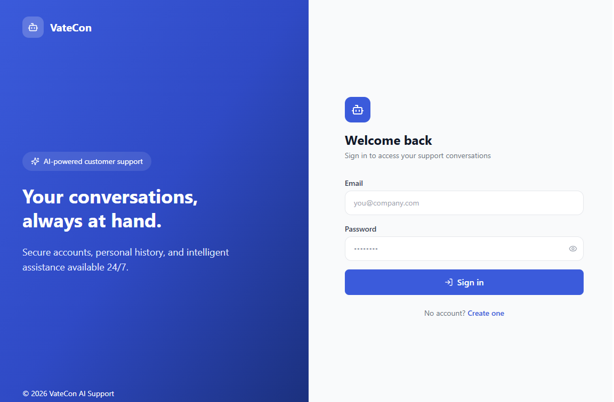
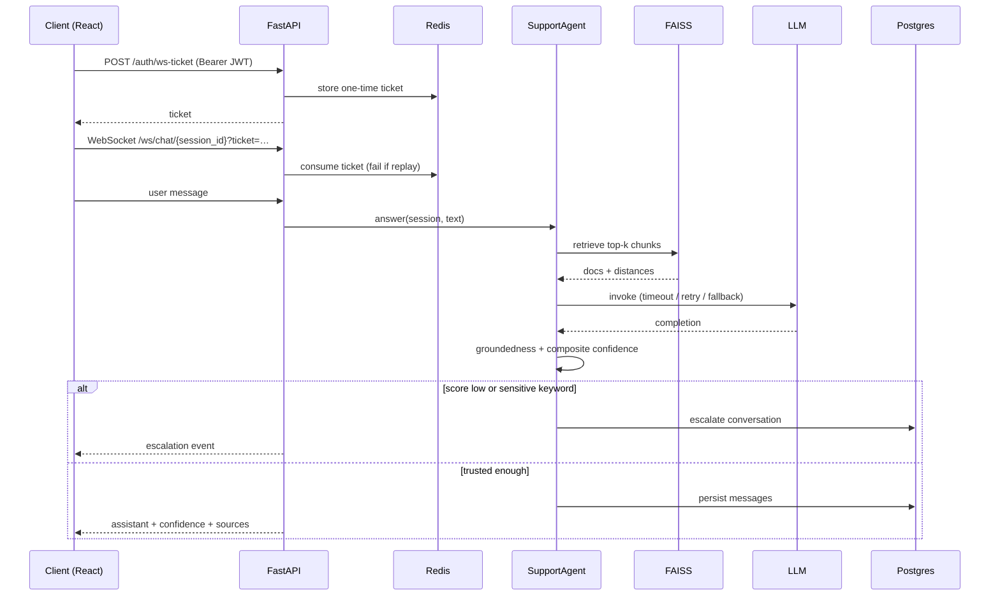
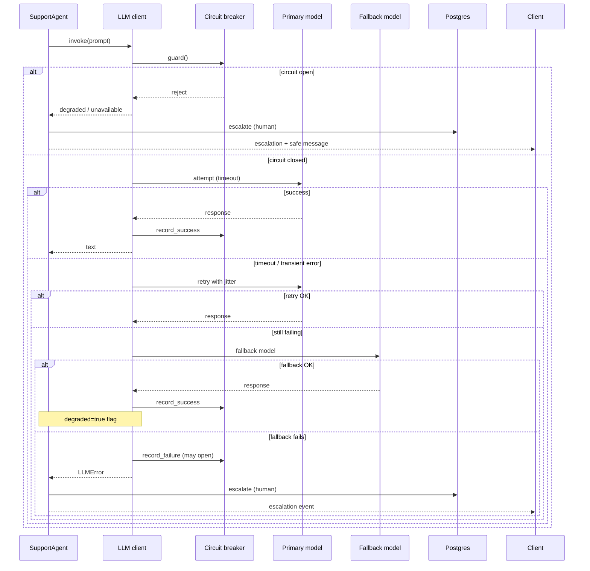
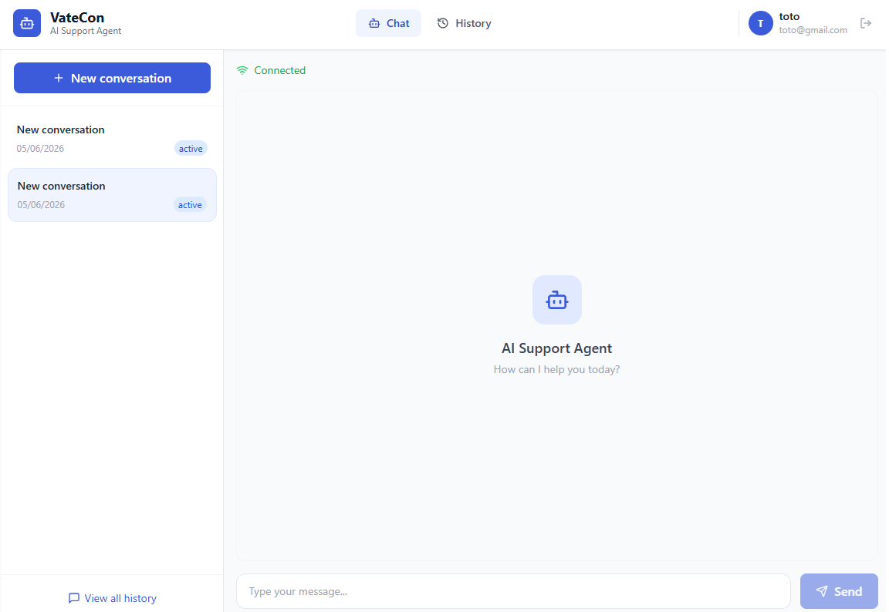
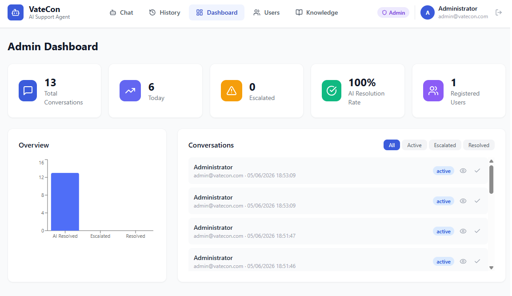
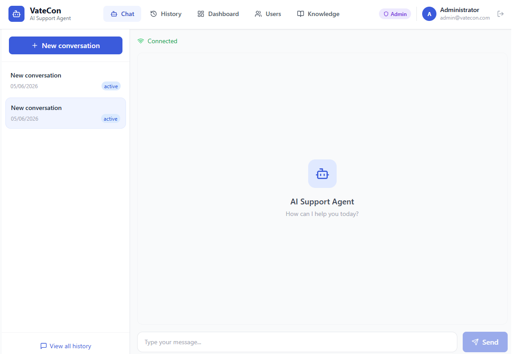
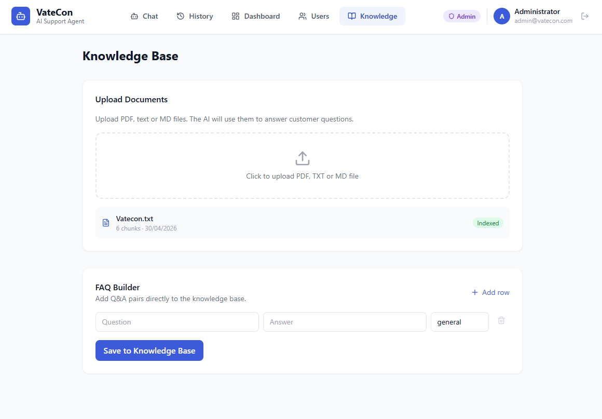

# VateCon — AI Support Agent

> Système d'automatisation du support client basé sur l'IA .

---

## Démarrage rapide

### 1. Lancer l'application

**Prérequis :** [Docker Desktop](https://www.docker.com/products/docker-desktop/) et une clé API OpenAI.

```bash
cp .env.example .env
# Renseigner OPENAI_API_KEY dans .env, puis :
docker compose up --build
```

Premier démarrage : environ 3 à 5 minutes (téléchargement des images et installation des dépendances).

### 2. Se connecter

Ouvrir **http://localhost:3000** dans le navigateur. Les sessions non authentifiées sont redirigées vers la page de connexion.



**Compte administrateur** (créé automatiquement au premier démarrage) :

| Champ | Valeur |
|---|---|
| Email | `admin@vatecon.com` |
| Mot de passe | `Admin123!` |

**Compte utilisateur :** inscription libre sur http://localhost:3000/register (mot de passe minimum 8 caractères).

### 3. URLs de l'application

| Interface | URL |
|---|---|
| Connexion | http://localhost:3000/login |
| Inscription | http://localhost:3000/register |
| Chat | http://localhost:3000 |
| Historique | http://localhost:3000/history |
| Dashboard admin | http://localhost:3000/admin |
| Gestion utilisateurs | http://localhost:3000/admin/users |
| Knowledge Base | http://localhost:3000/knowledge |
| Documentation API | http://localhost:8000/docs |

> **Sécurité :** conserver `COOKIE_SECURE=false` en local (HTTP). En production derrière HTTPS, définir `COOKIE_SECURE=true` dans `.env`.

---

## Présentation

VateCon AI Support Agent est un assistant de support RAG : réponses
en temps réel, citations de sources, score de confiance composite, et
escalade des cas peu fiables ou sensibles vers un humain.

Nous n’affirmons **pas** un taux invérifiable « 70–80 % de tickets
automatisés ». L’évaluation offline sur un jeu synthétique étiqueté
(`nimbusdesk-v1`, 180 questions) mesure actuellement :

| Métrique | Valeur |
|----------|-------:|
| recall@5 | **0.625** |
| MRR | 0.547 |
| F1 escalade | 0.559 |
| ECE (confiance) | 0.275 |

Tableaux complets, date, modèle et limites :
[evaluation/RESULTS.md](evaluation/RESULTS.md).
Méthodologie : [evaluation/README.md](evaluation/README.md).

**Stack technique :**
- **Backend** : FastAPI + LangChain + OpenAI GPT-4o + FAISS (RAG) + PostgreSQL
- **Frontend** : React + TypeScript + Tailwind CSS + WebSocket
- **Infrastructure** : Docker Compose (4 services orchestrés)

---

## Backend — rôle et fonctionnement

Le **backend** est l'API centrale de VateCon. Il expose une API REST et une connexion WebSocket que le frontend consomme. Il ne possède pas d'interface graphique : tout passe par HTTP/JSON ou WebSocket.

### Ce que fait le backend

| Responsabilité | Description |
|---|---|
| **Authentification** | Inscription, connexion, JWT (15 min) + refresh token en cookie httpOnly sécurisé |
| **Chat IA** | WebSocket temps réel, appel à GPT-4o via LangChain, score de confiance |
| **RAG** | Indexation de documents (PDF, TXT, MD) et FAQ dans FAISS pour enrichir les réponses |
| **Persistance** | Stockage des utilisateurs, conversations et messages dans PostgreSQL |
| **Escalade** | Détection automatique (confiance < 50 % ou mots-clés sensibles) |
| **Administration** | Statistiques globales, gestion des conversations et des utilisateurs |
| **Knowledge Base** | Upload de documents et ajout de FAQ (réservé aux admins) |

### Structure du dossier `backend/`

```
backend/
├── app/
│   ├── main.py          # Point d'entrée FastAPI, CORS, enregistrement des routes
│   ├── config.py        # Variables d'environnement (.env)
│   ├── database.py      # Connexion PostgreSQL (SQLAlchemy async)
│   ├── models.py        # Modèles : User, Conversation, Message, KnowledgeDocument
│   ├── agent.py         # Agent IA LangChain + vectorstore FAISS
│   ├── security.py      # Hash mot de passe, création/vérification JWT
│   ├── deps.py          # Dépendances auth (get_current_user, require_admin)
│   ├── seed.py          # Création du compte admin au premier démarrage
│   └── routes/
│       ├── auth.py      # /auth/* — login, register, refresh, logout, me
│       ├── me.py        # /me/* — conversations de l'utilisateur connecté
│       ├── chat.py      # /ws/chat/{session_id} — WebSocket chat
│       ├── admin.py     # /admin/* — dashboard (admin only)
│       └── knowledge.py # /knowledge/* — base de connaissances (admin only)
├── requirements.txt
└── Dockerfile
```

### Endpoints principaux

| Méthode | Route | Accès | Rôle |
|---|---|---|---|
| `POST` | `/auth/register` | Public | Créer un compte utilisateur |
| `POST` | `/auth/login` | Public | Se connecter |
| `POST` | `/auth/refresh` | Cookie httpOnly | Renouveler le token d'accès |
| `POST` | `/auth/logout` | Connecté | Se déconnecter |
| `GET` | `/auth/me` | Connecté | Profil courant |
| `GET` | `/me/conversations` | Connecté | Historique personnel |
| `WS` | `/ws/chat/{session_id}?token=...` | Connecté | Chat temps réel |
| `GET` | `/admin/stats` | Admin | Statistiques globales |
| `GET` | `/admin/users` | Admin | Liste des utilisateurs |
| `POST` | `/knowledge/upload` | Admin | Upload document |
| `GET` | `/health` | Public | Santé du service |

Documentation interactive : http://localhost:8000/docs

### Lancer le backend seul (sans Docker)

Prérequis : Python 3.11+, PostgreSQL en cours d'exécution.

```bash
cd backend
python -m venv venv
venv\Scripts\activate        # Windows
# source venv/bin/activate   # Linux / macOS
pip install -r requirements.txt
```

Configurer `.env` à la racine du projet (voir section Variables d'environnement), puis :

```bash
uvicorn app.main:app --reload --host 0.0.0.0 --port 8000
```

Le backend sera accessible sur http://localhost:8000.

---

## Frontend — rôle et utilisation

Le **frontend** est l'interface web React que les utilisateurs et admins utilisent dans le navigateur. Il communique avec le backend via `/api/*` (proxy Nginx en production, proxy Vite en développement).

### Ce que fait le frontend

| Page | Route | Qui y accède | Rôle |
|---|---|---|---|
| **Connexion** | `/login` | Public | Se connecter |
| **Inscription** | `/register` | Public | Créer un compte |
| **Chat** | `/` | Utilisateur connecté | Discuter avec l'agent IA, sidebar des conversations |
| **Historique** | `/history` | Utilisateur connecté | Voir toutes ses conversations passées |
| **Dashboard** | `/admin` | Admin | Stats globales, toutes les conversations |
| **Utilisateurs** | `/admin/users` | Admin | Gérer les comptes (activer / désactiver) |
| **Knowledge Base** | `/knowledge` | Admin | Upload docs + FAQ builder |

### Structure du dossier `frontend/`

```
frontend/src/
├── main.tsx              # Point d'entrée React
├── App.tsx               # Routes et navigation
├── context/
│   └── AuthContext.tsx   # État auth global (user, login, logout)
├── lib/
│   └── api.ts            # Client HTTP avec token + refresh automatique
├── hooks/
│   └── useChat.ts        # WebSocket chat (messages, typing, escalade)
├── components/
│   ├── ProtectedRoute.tsx  # Garde d'accès (login requis, rôle admin)
│   ├── AuthLayout.tsx      # Layout split-screen login/register
│   └── UserMenu.tsx        # Avatar + déconnexion
└── pages/
    ├── ChatPage.tsx
    ├── HistoryPage.tsx
    ├── LoginPage.tsx
    ├── RegisterPage.tsx
    ├── AdminPage.tsx
    ├── AdminUsersPage.tsx
    └── KnowledgePage.tsx
```

### Comptes par défaut

| Rôle | Email | Mot de passe |
|---|---|---|
| Admin (créé au 1er démarrage) | `admin@vatecon.com` | `Admin123!` |
| Utilisateur | Inscription libre sur `/register` | min. 8 caractères |

### Lancer le frontend seul (mode développement)

Prérequis : Node.js 18+, backend déjà lancé sur le port 8000.

```bash
cd frontend
npm install
npm run dev
```

Le frontend démarre sur http://localhost:5173 (port Vite par défaut).

Le fichier `vite.config.ts` redirige automatiquement :
- `/api/*` → `http://localhost:8000/*`
- `/ws/*` → WebSocket backend

> **Note :** en mode dev, ouvrir http://localhost:5173. Avec Docker, tout est servi sur http://localhost:3000.

### Commandes frontend utiles

```bash
npm run dev       # Serveur de développement (hot reload)
npm run build     # Build de production (dossier dist/)
npm run preview   # Prévisualiser le build localement
```

### Build de production (sans Docker)

```bash
cd frontend
npm install
npm run build
```

Les fichiers statiques sont générés dans `frontend/dist/`. En production, Nginx les sert et proxyfie `/api/` et `/ws/` vers le backend (voir `frontend/nginx.conf`).

---

## Architecture

Carte complète : [docs/architecture.md](docs/architecture.md).
Décisions : [docs/adr/](docs/adr/README.md).

### Chemin nominal (tour de chat)



### Chemin dégradé (échec LLM)



### Décisions d'architecture

| ADR | Décision |
|-----|----------|
| [0001](docs/adr/0001-vector-store.md) | Garder FAISS ; contenir la concurrence et nommer les limites |
| [0002](docs/adr/0002-faiss-vs-managed.md) | FAISS tant que les seuils mesurés ne sautent pas |
| [0003](docs/adr/0003-websocket-vs-sse.md) | WebSocket pour le chat duplex (pas SSE/polling) |
| [0004](docs/adr/0004-composite-confidence.md) | Confiance composite ; rejeter l'auto-score LLM |
| [0005](docs/adr/0005-markdown-header-chunking.md) | MarkdownHeaderTextSplitter + repli récursif |
| [0006](docs/adr/0006-jwt-refresh-cookie.md) | JWT court + refresh httpOnly |

### Limites et non-objectifs

VateCon est une démo RAG de support au niveau portfolio, avec des
*pratiques* de production — pas un SaaS multi-tenant complet. En
particulier, le système **ne** :

- **ne** revendique **pas** un « X % de tickets automatisés » vérifié —
  seulement des métriques offline dans
  [evaluation/RESULTS.md](evaluation/RESULTS.md)
- **n'**utilise **pas** de vector DB managée (FAISS sur volume ;
  ADR 0001/0002)
- **ne** scale **pas** plusieurs writers d'ingest sans file durable
- **n'**isole **pas** la knowledge base par tenant
- **ne** garantit **pas** une confiance calibrée sur le trafic live
  (ECE offline modéré)
- **ne** streame **pas** token par token (événements au niveau tour)
- **ne** remplace **pas** un humain pour remboursements, fraude ou
  décisions légales — escalade prévue
- **n'**offre **pas** SOC2 / HIPAA / clés client out of the box

Détails : [docs/](docs/architecture.md), [SECURITY.md](SECURITY.md),
[CONTRIBUTING.md](CONTRIBUTING.md).

---

## Fonctionnalités

### Authentification

- **Inscription ouverte** : tout le monde peut créer un compte utilisateur
- **JWT** : token d'accès court (15 min) en mémoire côté frontend
- **Refresh token** : cookie httpOnly sécurisé (non accessible en JavaScript)
- Chaque utilisateur voit **uniquement ses conversations**
- L'admin voit **toutes** les conversations et gère la Knowledge Base

### Interface de chat (`/`)



- Sidebar avec la liste des conversations récentes
- Connexion WebSocket sécurisée (token JWT requis)
- Indicateur de frappe pendant que l'IA génère la réponse
- Affichage du **score de confiance** sur chaque réponse (0–100 %)
- Sources citées (nom du document utilisé pour répondre)
- Bannière d'escalade visible quand la conversation est transférée à un humain

### Dashboard admin (`/admin`)



- Statistiques globales : nombre de conversations, taux de résolution IA, escalades, conversations du jour
- Graphique de répartition (résolues par IA / escaladées / clôturées)
- Liste des conversations avec filtres par statut (active, escalated, resolved)
- Visualisation complète des messages d'une conversation
- Bouton de clôture manuelle d'une conversation

### Gestion des utilisateurs (`/admin/users`)



- Liste de tous les comptes inscrits
- Nombre de conversations par utilisateur
- Activation / désactivation d'un compte

### Knowledge Base (`/knowledge`)



**Upload de documents**
Déposer un fichier PDF ou TXT. Le système le découpe automatiquement en chunks, génère les embeddings via OpenAI et les indexe dans FAISS. L'agent utilise ensuite ces informations pour répondre aux clients.

**FAQ Builder**
Ajouter directement des paires Question / Réponse sans passer par un fichier. Idéal pour les réponses standard (tarifs, politique de remboursement, horaires...).

### Escalade automatique

L'agent escalade automatiquement une conversation dans deux cas :
1. **Score de confiance < 50 %** — la réponse n'est pas assez fiable
2. **Mot-clé sensible détecté** — remboursement, fraude, parler à un humain, etc.

---

```bash
# Prérequis pour les notebooks de test
pip install requests websocket-client colorama
```

---

## Variables d'environnement

| Variable | Description | Défaut |
|---|---|---|
| `OPENAI_API_KEY` | Clé API OpenAI | — |
| `OPENAI_MODEL` | Modèle utilisé | `gpt-4o` |
| `POSTGRES_USER` | Utilisateur PostgreSQL | `vatecon` |
| `POSTGRES_PASSWORD` | Mot de passe PostgreSQL | `vatecon_secret` |
| `POSTGRES_DB` | Nom de la base de données | `vatecon_db` |
| `SECRET_KEY` | Clé secrète JWT (obligatoire en prod) | — |
| `ADMIN_EMAIL` | Email du compte admin initial | `admin@vatecon.com` |
| `ADMIN_PASSWORD` | Mot de passe admin initial | `Admin123!` |
| `ACCESS_TOKEN_EXPIRE_MINUTES` | Durée du token d'accès | `15` |
| `REFRESH_TOKEN_EXPIRE_DAYS` | Durée du refresh token | `7` |
| `ENVIRONMENT` | Environnement (`development` / `production`) | `development` |
| `COOKIE_SECURE` | Cookie refresh en HTTPS uniquement (mettre `true` en prod HTTPS) | `false` |

---

## Pitch commercial

| Problème | Solution |
|---|---|
| Une équipe support répond aux mêmes questions 50x par jour | Qualité mesurée (retrieval / escalade) — voir [RESULTS.md](evaluation/RESULTS.md) |
| Former un chatbot prend des mois | Déposer ses docs suffit — opérationnel en minutes |
| Les réponses incorrectes nuisent à la réputation | Score de confiance + escalade automatique vers un humain |
| Pas de visibilité sur le support | Dashboard temps réel avec toutes les conversations |

**ROI typique pour une PME :** 5 à 15 heures économisées par semaine sur le support client.
